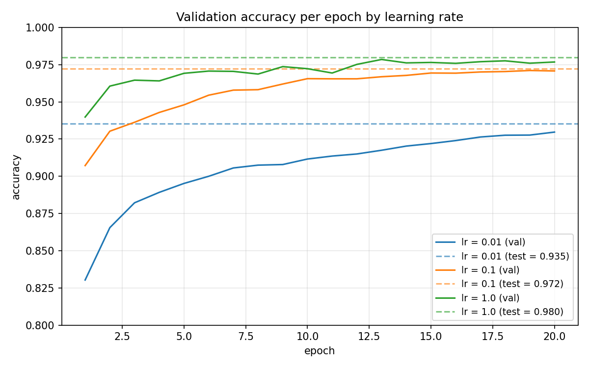
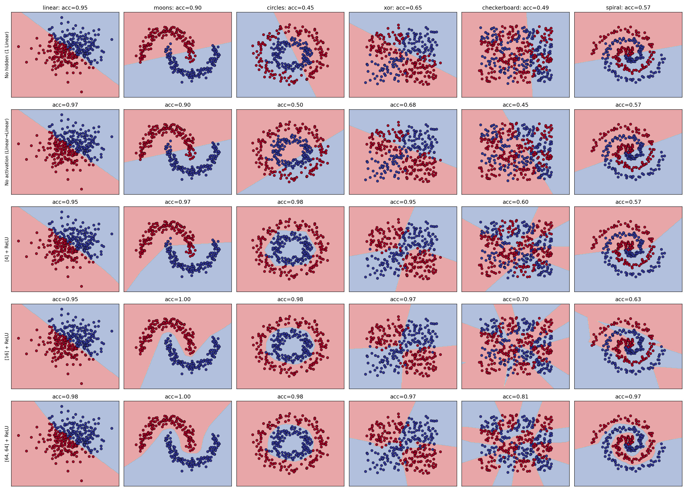
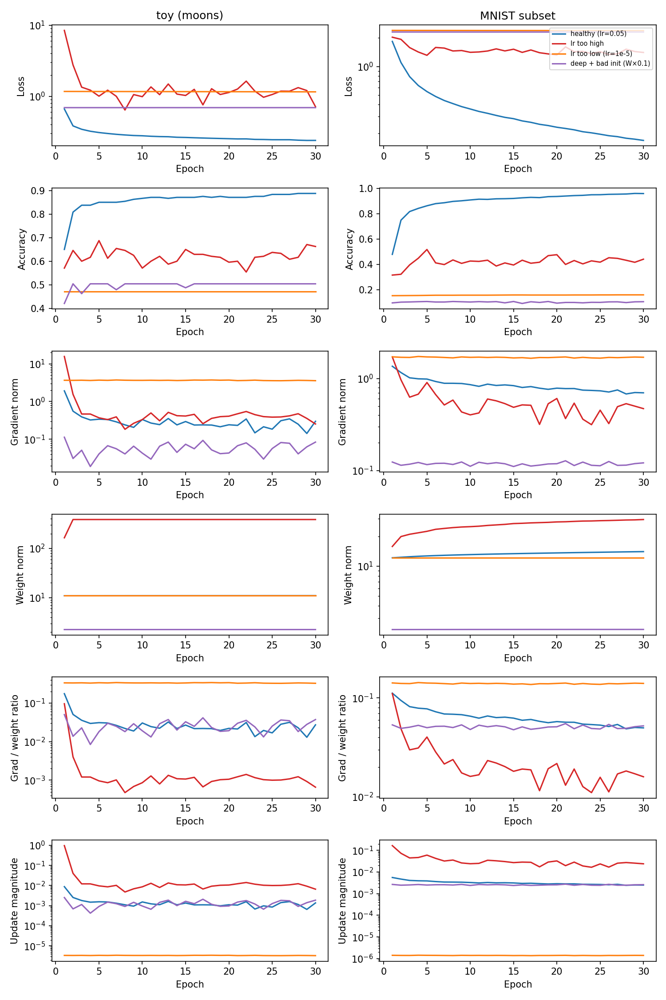
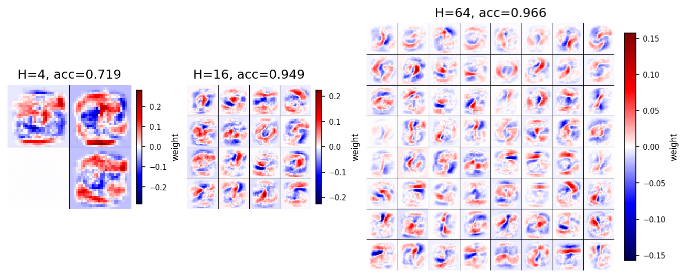

# Assignment 4 — Neural Networks in NumPy

<!-- BEGIN PORTFOLIO -->
## About this assignment (portfolio)

In this assignment, students build a fully-connected neural network from
scratch in NumPy, with no autograd. They then train it on MNIST and on 2D
toy datasets. Sixteen tasks cover linear layers, activations,
softmax/cross-entropy, backpropagation, dropout, SGD/momentum/Adam, data
loading, metrics, and the training loop. Six observe-only experiments
follow (decision boundaries, training diagnostics, regression, input
scaling, hyperparameters, and first-layer weight visualization).

This folder is the **full instructor tree**. The reference solutions sit in
`src/` between `### BEGIN SOLUTION` / `### END SOLUTION` markers.
`package.py` strips them out, stubs the tests, and builds the student
release zip.

| Path | Contents |
|------|----------|
| `task_prompts/` | The written assignment, one Markdown prompt per task (a–p) |
| `src/` | Reference implementation (layers, losses, optimizers, data, metrics, experiments, plots) |
| `tests/` | 256 pytest tests |
| `results/figures/` | Figures produced by the experiment demos (seed 0) |
| `grader/`, `assignment4.yaml`, `submission_instructor.json` | Hash-based auto-grader and its manifest |
| `package.py`, `instructor_tools/` | Release pipeline: compile reference, compile grader, package, patch |
| `solution.py` | Answer key for the observe-only questions in `answers.py` |
| `CLAUDE.md` | Assignment spec (student assumptions, task index, requirements) |

### Results

Learning-rate sweep (task j), architecture `784 → 128 → 10`, 20 epochs, seed
0. Test accuracy: lr=0.01 → 0.9345, lr=0.1 → 0.9737, lr=1.0 → 0.9777.



Decision boundaries on 2D toy data as depth and width grow (task k):



Gradient and weight diagnostics for healthy and pathological training runs
(task l):



First-layer weights learned on MNIST (task p):



The other figures are in `results/figures/`. Run the demos below to
regenerate any of them. MNIST downloads to `data/raw/` on first use.

### Instructor commands

```bash
make test                # run all tests against the reference solution
make release             # compile reference + grader, then build the student zip
```

---
<!-- END PORTFOLIO -->

## Student instructions

A from-scratch neural network implemented using NumPy.
You will build the network piece by piece across sixteen tasks.

## Setup

```bash
make install
```

## Tasks

Read the prompt files in `task_prompts/` in order.
Tasks b–j require implementation; tasks k–p are observe-only experiments.

| Prompt | Topic | Files to implement |
|--------|-------|--------------------|
| `b_linear.md` | Linear layer | `src/nn/linear.py` |
| `c_activation.md` | ReLU, LeakyReLU, GELU | `src/nn/activations.py` |
| `d_loss.md` | CrossEntropy and MSE | `src/nn/loss.py` |
| `e_regularization.md` | Dropout | `src/nn/dropout.py` |
| `f_models.md` | Sequential and MLP | `src/nn/sequential.py`, `src/nn/mlp.py` |
| `g_optim.md` | SGD and Adam | `src/optim/sgd.py`, `src/optim/adam.py` |
| `h_data-handling.md` | Dataset and DataLoader | `src/data/dataset.py`, `src/data/dataloader.py` |
| `i_metrics.md` | Accuracy and ConfusionMatrix | `src/evaluation/accuracy.py`, `src/evaluation/confusion_matrix.py` |
| `j_training.md` | Training loop | `src/training/train_ffnn.py` |

## Running tests

```bash
make test-b   # Linear layer (task b)
make test-c   # Activation functions (task c)
make test-d   # Loss functions (task d)
make test-e   # Dropout (task e)
make test-f   # Sequential and MLP (task f)
make test-g   # SGD and Adam (task g)
make test-h   # Dataset and DataLoader (task h)
make test-i   # Accuracy and ConfusionMatrix (task i)
make test-j   # Training loop (task j)
make test     # All tests
```

## Running experiment demos

```bash
make demo-task-j   # learning-rate sweep (task j)
make demo-task-k   # decision boundaries (task k)
make demo-task-l   # training diagnostics (task l)
make demo-task-m   # regression (task m)
make demo-task-n   # input scaling (task n)
make demo-task-o   # hyperparameter experiments (task o)
make demo-task-p   # first-layer weight visualization (task p)
```

## Submitting

```bash
make submit-b   # submit task b (Linear layer)
make submit-c   # submit task c (activations)
make submit-d   # submit task d (loss functions)
make submit-e   # submit task e (Dropout)
make submit-f   # submit task f (Sequential and MLP)
make submit-g   # submit task g (SGD and Adam)
make submit-h   # submit task h (Dataset and DataLoader)
make submit-i   # submit task i (metrics)
make submit-j   # submit task j (training loop)
make submit     # submit all tasks
```

This writes `submission.json`, which you upload to the course webpage.

## Reference mode

A compiled reference implementation is included in `src_reference/`. You
can use it to run demos and tests without having implemented anything
yourself.
<!-- BEGIN PORTFOLIO -->
(In this portfolio copy, `src_reference/` isn't included. Run
`make compile-reference` to generate it.)
<!-- END PORTFOLIO -->

```bash
make use-reference   # switch src/ to the reference implementation
make use-student     # switch back to your own implementation
```
